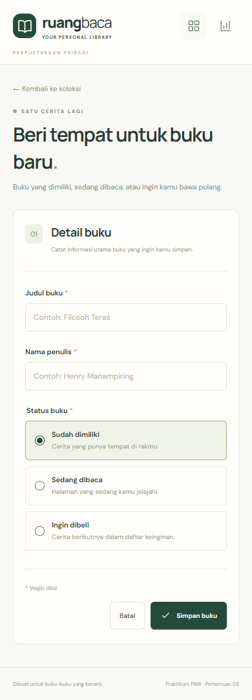

# Laporan Praktikum Pertemuan 3 — React Basics

**Nama:** Ray Regan Sitepu  
**NIM:** 123140047  
**Kelas:** isi RA / RB  
**Judul aplikasi:** Ruang Baca — Manajemen Buku Pribadi  
**Tanggal verifikasi:** 26 Oktober 2026

## 1. Tujuan

Membangun aplikasi React untuk mengelola koleksi buku pribadi sambil menerapkan functional components, props, state, efek, Context API, routing, custom hooks, penyimpanan lokal, dan pengujian komponen.

## 2. Alat dan teknologi

| Alat | Versi yang digunakan |
| --- | --- |
| Node.js | 24.19.0 |
| React / React DOM | 18.3.1 |
| Vite | 8.3.5 |
| React Router DOM | 7.18.4 |
| PropTypes | 15.8.1 |
| Vitest | 5.0.5 |
| React Testing Library | 16.3.3 |
| jsdom | 30.1.3 |

Versi dependensi dikunci dalam `package-lock.json`. Instalasi dapat direproduksi dengan `npm ci`.

## 3. Implementasi

### Pengelolaan state dan data

`BookProvider` membungkus aplikasi dan menyediakan `books`, `saveBook`, serta `deleteBook` melalui Context. Komponen mengaksesnya lewat `useBooks`, sehingga perubahan data segera diterapkan pada halaman koleksi dan statistik. Form dan filter menggunakan `useState` untuk state lokal.

Data buku memiliki `id`, `title`, `author`, `status`, dan `createdAt`. Status disimpan sebagai `milik`, `baca`, atau `beli`. Saat menyimpan, spasi di awal dan akhir judul serta penulis dibuang. Mengedit buku mempertahankan ID dan waktu penambahannya.

### Custom hooks

1. `useLocalStorage`: membaca JSON sekali pada inisialisasi state, memvalidasi struktur, lalu menyimpan perubahan menggunakan `useEffect`. Jika data rusak, data awal tidak ditimpa sebelum pengguna memilih pemulihan. Jika penulisan gagal, state tetap tersedia di memori dan aplikasi menampilkan peringatan.
2. `useBookStats`: menghitung total buku, jumlah setiap status, serta penulis unik. `useMemo` menghindari perhitungan ulang saat data buku tidak berubah.

### Komponen dan navigasi

Komponen reusable meliputi `BookForm`, `BookFilter`, `BookList`, `BookCard`, `StatCard`, `ConfirmDialog`, dan `Icon`. Seluruh komponen memiliki deklarasi PropTypes; komponen tanpa props mendeklarasikan objek kosong. `bookShape` membagikan aturan model buku antar komponen.

React Router menyediakan halaman koleksi (`/`), statistik (`/stats`), tambah (`/books/new`), dan edit (`/books/:id/edit`). Rute tidak dikenal dan ID buku yang tidak ditemukan menampilkan feedback yang sesuai.

### Validasi dan aksesibilitas

Judul dan penulis wajib diisi, tidak boleh hanya spasi, dan dibatasi masing-masing 150 serta 100 karakter. Input yang bermasalah mendapat pesan dan atribut `aria-invalid`, lalu fokus dipindahkan ke kolom pertama yang bermasalah. Dialog hapus memerlukan konfirmasi, mendukung Escape, membatasi fokus di dalam dialog, dan mengembalikan fokus ke pemicu ketika dibatalkan. Pencarian, tombol ikon, navigasi, dan progress statistik memiliki label aksesibel.

## 4. Skenario pengujian otomatis

Perintah yang dijalankan:

```bash
npm run test:coverage -- --reporter=verbose
npm run build
```

| No. | Skenario | Hasil |
| --- | --- | --- |
| 1 | Keadaan kosong dan memuat enam buku contoh atas pilihan pengguna | Lulus |
| 2 | Judul/penulis kosong ditolak dan fokus diarahkan ke input | Lulus |
| 3 | Input hanya spasi ditolak | Lulus |
| 4 | Tambah buku, trim input, navigasi kembali, dan penyimpanan data | Lulus |
| 5 | Edit judul/status tanpa menambah jumlah buku | Lulus |
| 6 | Batal hapus mempertahankan data, konfirmasi menghapus buku | Lulus |
| 7 | Escape menutup dialog dan mengembalikan fokus | Lulus |
| 8 | Filter status dan pencarian penulis bekerja bersamaan serta dapat direset | Lulus |
| 9 | Pencarian sebagian judul tidak membedakan huruf besar/kecil | Lulus |
| 10 | Data tersedia setelah aplikasi dipasang ulang | Lulus |
| 11 | Navigasi statistik dan persentase berdasarkan koleksi | Lulus |
| 12 | Tautan edit dengan ID tidak tersedia | Lulus |
| 13 | Rute tidak dikenal | Lulus |
| 14 | JSON rusak aman dan pemulihan dilakukan secara eksplisit | Lulus |
| 15 | Hitungan status dan penulis unik pada custom hook | Lulus |
| 16 | Statistik koleksi kosong menghasilkan nilai nol | Lulus |
| 17 | Pembaruan fungsional custom hook tersimpan ke localStorage | Lulus |
| 18 | Gagal menulis penyimpanan memberi feedback dan mempertahankan state | Lulus |
| 19 | Struktur buku tidak valid ditolak ketika dibaca | Lulus |

Pengujian dijalankan sebelum folder sementara `NAMA_NIM_pertemuan3` diberi nama akhir `RAY_REGAN_SITEPU_123140047_pertemuan3`; karena itu output asli masih mencatat nama folder sementara. Perubahan terakhir hanya pada nama folder dan identitas dokumentasi.

**Hasil:** 2 file pengujian lulus, **19 test lulus**, 0 gagal. Build produksi berhasil. Coverage baris **95,42%**, statement **89,60%**, branch **81,67%**, dan fungsi **95,45%**. Coverage belum 100%; hasil ini mencakup skenario yang diuji, bukan jaminan untuk setiap kemungkinan kondisi browser.


Screenshot di atas menampilkan ulang output asli proses terminal agar dapat dibaca dalam laporan. Sumber lengkap: [unit-test-output.txt](docs/unit-test-output.txt). Versi HTML: [unit-test-report.html](docs/unit-test-report.html).

## 5. Pemeriksaan browser dan antarmuka

Pengujian interaksi dilakukan pada Microsoft Edge 156.0.4314.42 dengan ukuran desktop 1440 × 1080 dan ponsel 390 × 844. Pemeriksaan meliputi keadaan kosong, memuat contoh, validasi, tambah buku, reload untuk memastikan persistensi, edit, konfirmasi hapus, dan navigasi statistik. Tidak ditemukan kesalahan JavaScript atau overflow horizontal pada koleksi desktop, koleksi ponsel, dan form ponsel yang diperiksa. Ringkasan terstruktur tersedia di [browser-checks.json](docs/browser-checks.json).

### Koleksi desktop


### Form dan feedback validasi


### Statistik


### Koleksi dan form ponsel




## 6. Batasan

- Data berada di localStorage browser, belum menggunakan backend dan belum tersinkron antarperangkat.
- Menghapus data browser akan menghapus koleksi.
- Setiap buku menggunakan satu status aktif. Status `baca` tidak otomatis dihitung lagi sebagai `milik`.
- Pilih kelas RA / RB pada identitas laporan sesuai kelas praktikum.

## 7. Referensi

- [Instruksi tugas Pertemuan 3](https://praktikum-paw20262027.vercel.app/pertemuan/3/tugas-praktikum)
- [Format pengumpulan Pertemuan 3](https://praktikum-paw20262027.vercel.app/pertemuan/3/format-pengumpulan)
