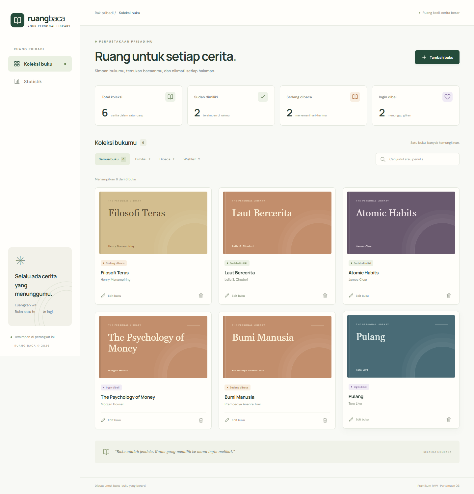
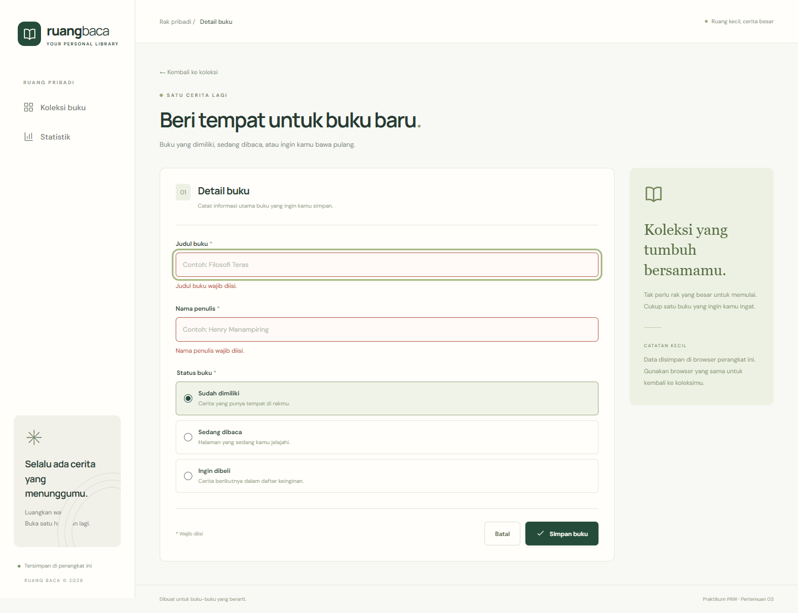
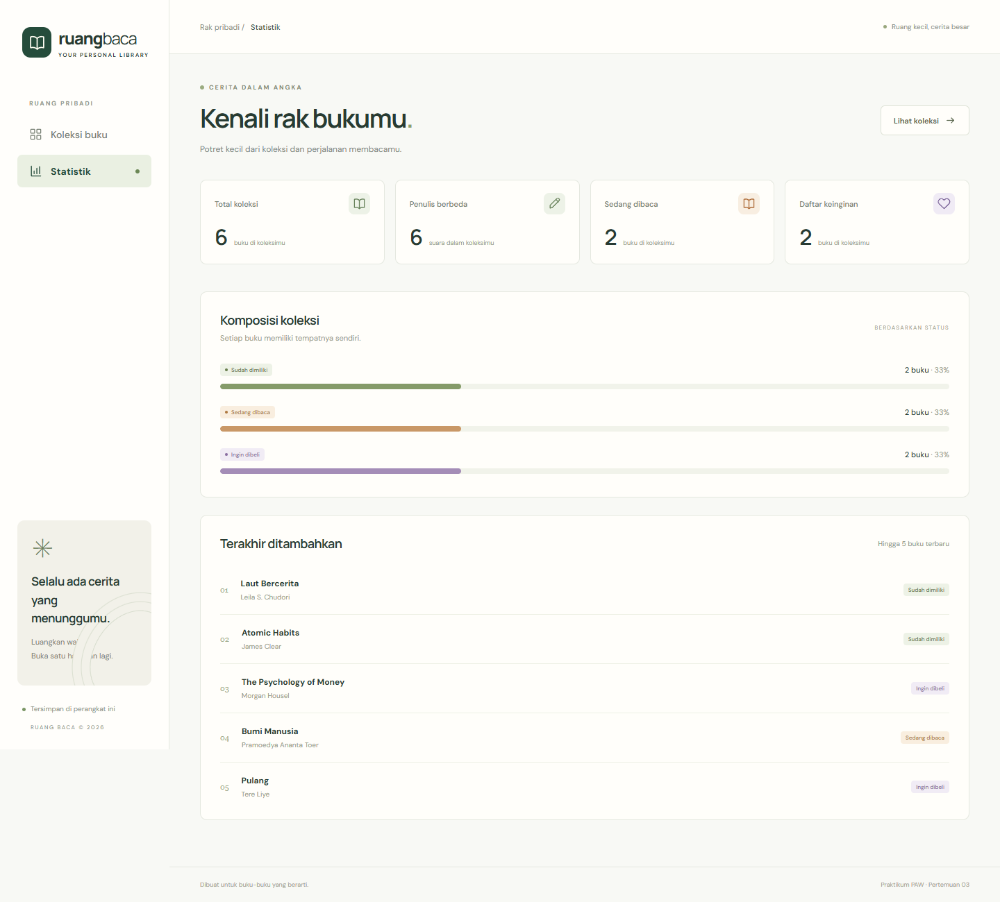
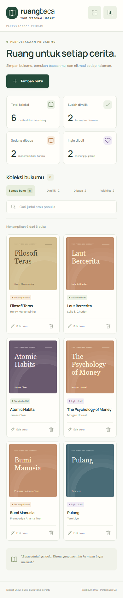
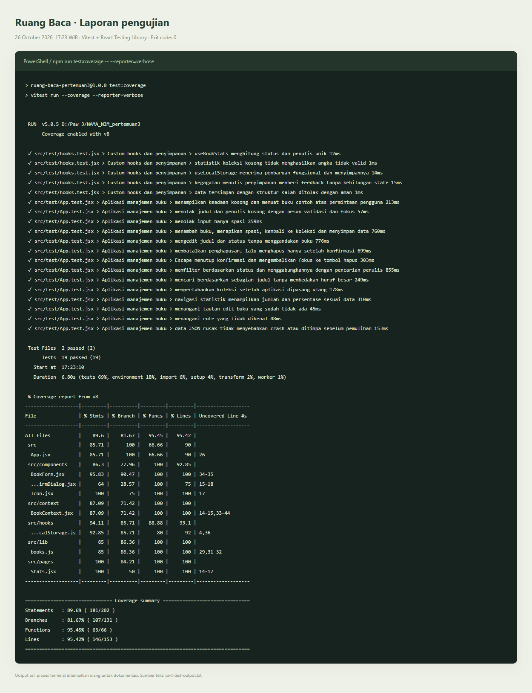

# Ruang Baca — Aplikasi Manajemen Buku Pribadi

Tugas Praktikum Pengembangan Aplikasi Web ITERA, Pertemuan 3: **React Basics**.

**Nama:** Ray Regan Sitepu  
**NIM:** 123140047  
**Kelas:** isi RA / RB

Ruang Baca membantu pengguna mencatat buku yang sudah dimiliki (`milik`), sedang dibaca (`baca`), atau ingin dibeli (`beli`). Aplikasi berbahasa Indonesia, responsif, dan menyimpan koleksi menggunakan localStorage.

## Instalasi dan menjalankan di VS Code

Prasyarat: Node.js **24 LTS** beserta npm dan VS Code. Proyek sudah diuji dengan Node.js 24.19.0.

1. Gunakan folder `RAY_REGAN_SITEPU_123140047_pertemuan3`. Nama dan NIM sudah diisi; lengkapi kelas RA / RB pada README dan laporan sebelum pengumpulan.
2. Pilih **File → Open Folder** di VS Code dan buka folder proyek tersebut.
3. Buka terminal VS Code, kemudian jalankan:

   ```bash
   npm install
   npm run dev
   ```

4. Buka alamat **Local** yang muncul di terminal, biasanya <http://127.0.0.1:5173>.

Pada PowerShell yang membatasi eksekusi `npm.ps1`, gunakan `npm.cmd install` dan `npm.cmd run dev`.

Untuk instalasi yang sama persis dengan lockfile, gunakan `npm ci` sebagai pengganti `npm install`.

## Cara menggunakan

1. Buka **Koleksi buku**, lalu klik **Tambah buku**.
2. Isi judul, nama penulis, dan satu status buku. Klik **Simpan buku**.
3. Gunakan kolom pencarian untuk mencari sebagian judul atau penulis. Huruf besar/kecil tidak dibedakan.
4. Pilih **Dimiliki**, **Dibaca**, atau **Wishlist** untuk memfilter status. Filter dan pencarian dapat dipakai bersamaan.
5. Klik **Edit buku** untuk memperbarui informasi. Klik ikon tempat sampah, lalu konfirmasi untuk menghapus.
6. Buka **Statistik** untuk melihat jumlah buku, penulis unik, komposisi status, dan lima buku terbaru.

Koleksi awal sengaja kosong. Tombol **Jelajahi dengan 6 buku contoh** tersedia jika ingin mencoba aplikasi dengan data contoh. Buku contoh dapat diedit dan dihapus seperti buku biasa.

Data disimpan dengan kunci `ruang-baca:books:v1`. Data mengikuti browser, profil, dan alamat situs yang digunakan. Menghapus data situs akan menghapus koleksi; aplikasi tidak melakukan sinkronisasi antarperangkat. Jika penyimpanan penuh atau tidak tersedia, aplikasi menampilkan peringatan. Data rusak tidak ditimpa sebelum pengguna memilih **Pulihkan penyimpanan**.

## Fitur dan penerapan React

| Ketentuan | Implementasi |
| --- | --- |
| Functional components | Seluruh komponen menggunakan fungsi dan Hooks |
| `useState` | Controlled form, validasi, pencarian, filter, dan konfirmasi hapus |
| `useEffect` | Menulis perubahan ke localStorage, membersihkan timer notifikasi, mengelola fokus dialog |
| Minimal 3 komponen reusable | `BookForm`, `BookList`, `BookCard`, `BookFilter`, `StatCard`, `ConfirmDialog`, `Icon` |
| Context API | `BookProvider` menyimpan koleksi dan menyediakan operasi tambah, edit, hapus, serta feedback |
| React Router | `/`, `/stats`, `/books/new`, `/books/:id/edit`, dan halaman 404 |
| Custom hook 1 | `useLocalStorage`: membaca/menulis data, menangani data rusak, kegagalan penyimpanan, dan pemulihan |
| Custom hook 2 | `useBookStats`: menghitung jumlah per status dan penulis unik dengan `useMemo` |
| Hook Context | `useBooks`: mengakses state global dengan pemeriksaan Provider |
| PropTypes | Dideklarasikan pada seluruh komponen; model buku memakai `bookShape` yang reusable |
| Persistensi | JSON di localStorage dengan validasi struktur saat dibaca |
| Error handling | Kolom wajib isi, penolakan spasi saja, batas panjang, pesan visual, fokus ke input bermasalah |
| Testing | 19 test menggunakan Vitest dan React Testing Library |

React 18 digunakan agar deklarasi PropTypes juga memberikan pemeriksaan props pada mode pengembangan. Buku memiliki ID unik melalui `crypto.randomUUID()` dan waktu penambahan yang dipertahankan ketika diedit. Komponen daftar menggunakan ID sebagai `key`.

## Struktur proyek

```text
RAY_REGAN_SITEPU_123140047_pertemuan3/
├── docs/                     # Screenshot dan bukti pengujian
├── public/favicon.svg
├── src/
│   ├── components/           # BookForm, BookFilter, BookList, BookCard,
│   │                        # ConfirmDialog, StatCard, Icon
│   ├── context/BookContext.jsx
│   ├── hooks/                # useLocalStorage dan useBookStats
│   ├── lib/books.js          # Model, status, validasi, data contoh
│   ├── pages/                # Home, Stats, BookEditor
│   ├── test/                 # Setup dan 19 test
│   ├── App.jsx
│   ├── main.jsx
│   └── styles.css
├── index.html
├── package.json
├── package-lock.json
├── vite.config.js
├── README.md
└── LAPORAN_PRAKTIKUM.md
```

## Pengujian dan build

```bash
npm test
npm run test:watch
npm run test:coverage
npm run build
npm run preview
```

- `npm test`: menjalankan semua test sekali.
- `npm run test:watch`: menjalankan ulang test saat kode berubah.
- `npm run test:coverage`: menampilkan coverage dan membuat laporan HTML di `coverage/index.html`.
- `npm run build`: menghasilkan versi produksi di `dist/`.
- `npm run preview`: menjalankan pratinjau hasil build.

Hasil pengujian pada **26 Oktober 2026**: **19/19 test lulus**, build produksi berhasil. Coverage baris **95,42%**, statement **89,60%**, branch **81,67%**, dan fungsi **95,45%**. Pemeriksaan browser Microsoft Edge berhasil pada viewport desktop **1440 × 1080** dan ponsel **390 × 844**, tanpa kesalahan JavaScript atau overflow horizontal pada halaman yang diperiksa.

Bukti lengkap: [laporan praktikum](LAPORAN_PRAKTIKUM.md), [output terminal asli](docs/unit-test-output.txt), [tampilan output pengujian](docs/unit-test-report.html), dan [hasil pemeriksaan browser](docs/browser-checks.json).

## Screenshot antarmuka

Screenshot koleksi menggunakan enam buku contoh, bukan data pengguna.

### Koleksi buku — desktop



### Validasi form



### Statistik



### Tampilan ponsel



### Hasil eksekusi unit test



Gambar pengujian merupakan output asli proses terminal yang ditampilkan ulang untuk dokumentasi. Versi teks lengkap tersedia di `docs/unit-test-output.txt`.

## Pengumpulan

Mengikuti [instruksi tugas](https://praktikum-paw20262027.vercel.app/pertemuan/3/tugas-praktikum) dan [format pengumpulan](https://praktikum-paw20262027.vercel.app/pertemuan/3/format-pengumpulan):

- Nama repositori: `pemrograman_web_itera_123140047`.
- Nama folder: `RAY_REGAN_SITEPU_123140047_pertemuan3`.
- Sertakan kode sumber, lockfile, README, laporan, dan screenshot di `docs/`.
- `node_modules/`, `dist/`, dan `coverage/` sudah diabaikan melalui `.gitignore`.
- Form pengumpulan: [kelas RA](https://forms.gle/J1dJrxXPGy1dtSs58) atau [kelas RB](https://forms.gle/vHRXZQZJuExcxoiNA).

Proyek ini disiapkan secara lokal. Unggah ke repositori dan kirim formulir sesuai kelas praktikum. Jika nantinya dihosting, gunakan hosting yang mendukung fallback rute SPA ke `index.html` agar refresh pada `/stats` atau rute edit tetap berfungsi.

Font DM Sans dan Manrope dimuat dari Google Fonts saat internet tersedia; aplikasi tetap dapat digunakan dengan font pengganti sistem.
