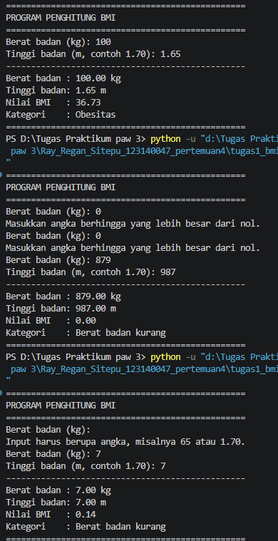
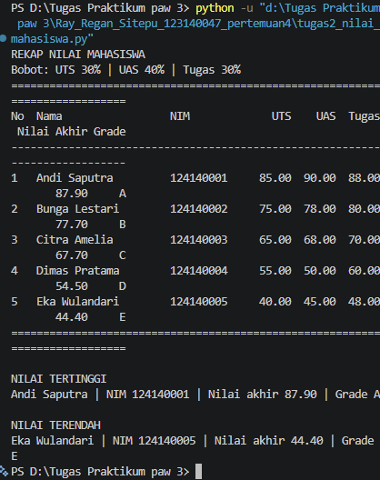
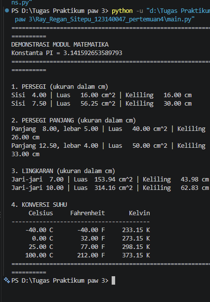

# Praktikum PAW — Pertemuan 4: Python Dasar

## Identitas

- Nama: **Ray Regan Sitepu**
- NIM: **123140047**

Sumber soal: [Modul Praktikum PAW ITERA, Pertemuan 4](https://praktikum-paw20262027.vercel.app/pertemuan/4#tugas-praktikum).

## Menjalankan program

Gunakan Python 3.10 atau lebih baru. Semua program hanya memakai pustaka
bawaan Python sehingga tidak memerlukan instalasi paket tambahan.

1. Buka folder ini di VS Code melalui **File → Open Folder**.
2. Buka **Terminal → New Terminal**. Pastikan terminal berada di folder ini.
3. Periksa Python dengan `python --version`.
4. Jalankan masing-masing perintah berikut:

```powershell
python tugas1_bmi.py
python tugas2_nilai_mahasiswa.py
python main.py
```

Jika perintah `python` tidak tersedia di Windows, gunakan `py`.
`math_operations.py` merupakan modul yang dipanggil oleh `main.py`.

## Soal 1 — Penghitung BMI

`tugas1_bmi.py` meminta berat dalam kilogram dan tinggi dalam meter.
Contoh input: `65` dan `1.70` (bukan `170`). Tanda koma desimal juga diterima.
Input yang bukan angka, tidak berhingga, nol, atau negatif akan diminta ulang.

- `baca_angka_positif(pesan)` membaca dan memvalidasi masukan pengguna.
- `hitung_bmi(berat, tinggi)` menghitung `berat / (tinggi * tinggi)`.
- `tentukan_kategori(bmi)` menggunakan `if-elif-else` untuk memilih kategori.
- `main()` menjalankan alur masukan, perhitungan, dan pencetakan.

| Rentang BMI | Kategori sesuai soal |
| --- | --- |
| BMI < 18.5 | Berat badan kurang |
| 18.5 ≤ BMI < 25 | Berat badan normal |
| 25 ≤ BMI < 30 | Berat badan berlebih |
| BMI ≥ 30 | Obesitas |

Nilai BMI ditampilkan dengan dua angka desimal, tetapi kategorinya ditentukan
dari nilai asli sebelum pembulatan. Contoh berat 65 kg dan tinggi 1.70 m
menghasilkan BMI **22.49**, kategori **Berat badan normal**.

## Soal 2 — Pengelolaan nilai mahasiswa

`tugas2_nilai_mahasiswa.py` menyimpan lima dictionary mahasiswa dalam satu
list. Data nama dan NIM di dalam program merupakan data fiktif untuk pengujian.
Setiap dictionary memuat `nama`, `nim`, `nilai_uts`, `nilai_uas`, dan
`nilai_tugas`. Nilai masukan berada pada rentang 0–100.

1. `hitung_nilai_akhir()` menghitung nilai dengan bobot UTS 30%, UAS 40%,
   dan tugas 30%.
2. `tentukan_grade()` mengelompokkan nilai akhir menjadi A (≥80), B (≥70),
   C (≥60), D (≥50), atau E (<50), tanpa membulatkan nilai terlebih dahulu.
3. `olah_nilai()` menghasilkan list baru yang menambahkan nilai akhir dan
   grade, sehingga data awal tetap dapat dipakai kembali.
4. `tampilkan_rekap()` menampilkan tabel serta mahasiswa dengan nilai
   tertinggi dan terendah. Semua mahasiswa dengan nilai ekstrem yang sama
   ikut ditampilkan.

| Nama | Nilai akhir | Grade |
| --- | ---: | :---: |
| Andi Saputra | 87.90 | A |
| Bunga Lestari | 77.70 | B |
| Citra Amelia | 67.70 | C |
| Dimas Pratama | 54.50 | D |
| Eka Wulandari | 44.40 | E |

Nilai tertinggi: **Andi Saputra (87.90)**.
Nilai terendah: **Eka Wulandari (44.40)**.

## Soal 3 — Modul matematika

`math_operations.py` mendefinisikan konstanta `PI` dan delapan fungsi berikut.
Dimensi geometri diasumsikan bernilai positif dan memakai satuan yang sama.

| Fungsi | Perhitungan / nilai kembali |
| --- | --- |
| `luas_persegi(sisi)` | sisi × sisi |
| `keliling_persegi(sisi)` | 4 × sisi |
| `luas_persegi_panjang(panjang, lebar)` | panjang × lebar |
| `keliling_persegi_panjang(panjang, lebar)` | 2 × (panjang + lebar) |
| `luas_lingkaran(jari_jari)` | PI × jari-jari² |
| `keliling_lingkaran(jari_jari)` | 2 × PI × jari-jari |
| `celsius_ke_fahrenheit(celsius)` | Celsius × 9/5 + 32 |
| `celsius_ke_kelvin(celsius)` | Celsius + 273.15 |

`main.py` memanggil seluruh fungsi dengan beberapa contoh ukuran dan suhu.
Dua cara impor yang digunakan:

```python
import math_operations
from math_operations import celsius_ke_fahrenheit, celsius_ke_kelvin
```

Fungsi geometri dipanggil melalui nama modul, sedangkan fungsi konversi
suhu dipanggil langsung. Hasil ditampilkan dengan dua angka desimal.
Contoh: persegi bersisi 4 cm memiliki luas 16 cm² dan keliling 16 cm;
0 °C dikonversi menjadi 32 °F dan 273.15 K.

## Bukti hasil eksekusi

Ketiga gambar berikut merupakan screenshot hasil eksekusi program di terminal
VS Code yang diberikan mahasiswa. Screenshot disimpan tanpa perubahan.

### Soal 1



Screenshot memperlihatkan beberapa percobaan masukan dan penanganan input
yang salah. Percobaan berat 100 kg dan tinggi 1.65 m menghasilkan BMI
**36.73**, kategori **Obesitas**. Screenshot disimpan tanpa perubahan.

### Soal 2



### Soal 3



## Format pengumpulan

- Nama repositori: `pemrograman_web_itera_123140047`.
- Nama folder tugas: `Ray_Regan_Sitepu_123140047_pertemuan4`.
- Sertakan kode, README, dan dokumentasi hasil eksekusi.
- `.gitignore` mengecualikan virtual environment dan cache Python.
