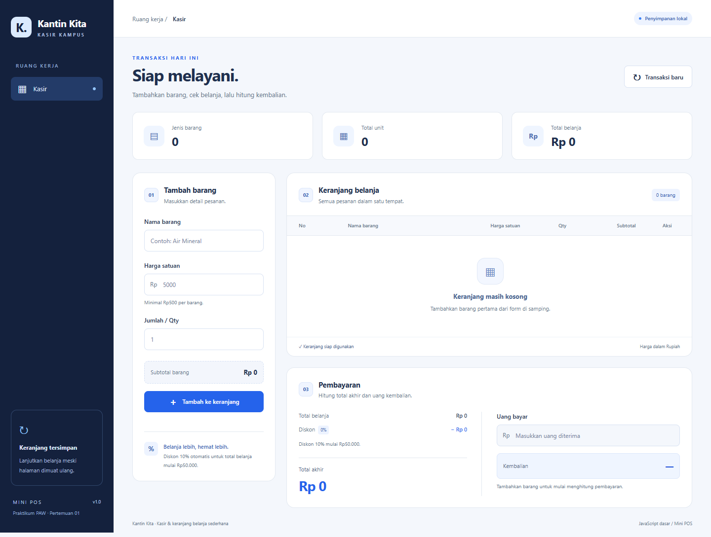
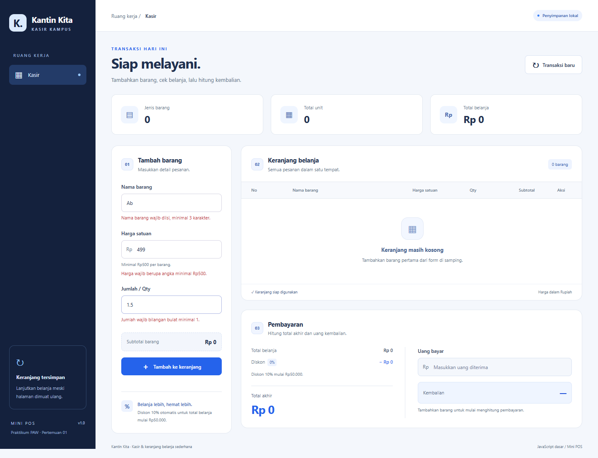
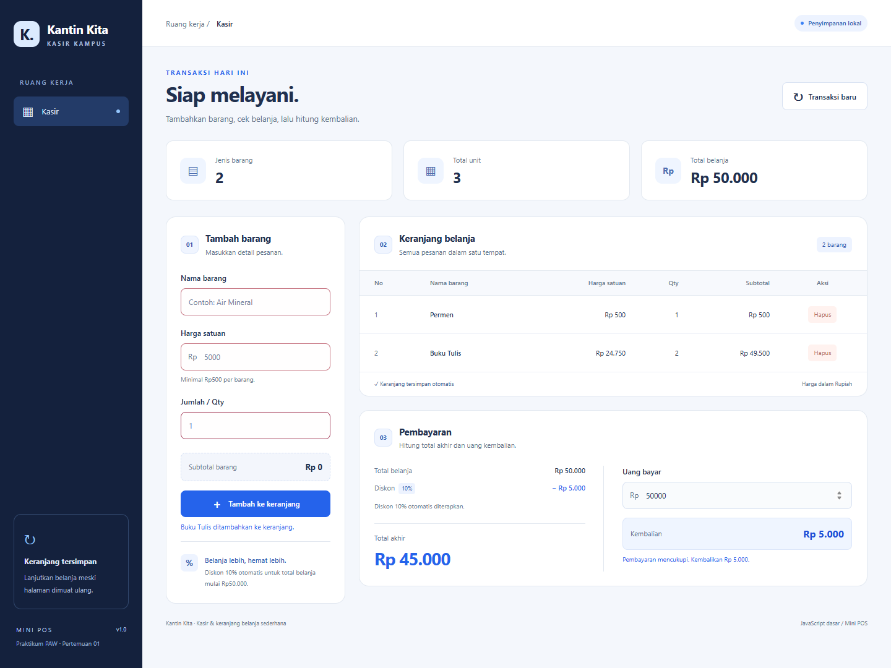

# Kantin Kita — Kasir Mini POS

Aplikasi kasir dan keranjang belanja sederhana untuk kantin atau toko kampus. Dibuat untuk tugas Praktikum Pengembangan Aplikasi Web ITERA, Pertemuan 1: JavaScript Dasar.

## Identitas

| Data | Isi |
| --- | --- |
| Nama lengkap | **Ray Regan Sitepu** |
| NIM | **123140047** |
| Kelas praktikum | **RA** |

> Identitas: Ray Regan Sitepu · 123140047 · Kelas RA.

## Deskripsi dan tujuan

Studi kasus: kasir kantin kampus mencatat barang yang dibeli, memeriksa harga dan jumlah, menghitung diskon dan kembalian, serta melanjutkan keranjang setelah halaman dimuat ulang. Implementasi memakai HTML, CSS, dan JavaScript tanpa framework atau proses build.

## Cara menjalankan

1. Buka folder proyek ini di Visual Studio Code.
2. Gunakan ekstensi **Live Server** yang tersedia pada VS Code.
3. Klik kanan `index.html`, lalu pilih **Open with Live Server**.
4. Isi nama barang, harga satuan, dan jumlah, kemudian klik **Tambah ke keranjang**.
5. Masukkan uang bayar pada bagian Pembayaran. Kembalian dihitung langsung saat nominal berubah.
6. Klik **Transaksi baru**, lalu **Ya, kosongkan** untuk menghapus keranjang dan memulai transaksi berikutnya.

Aplikasi kasir dapat dibuka langsung melalui `index.html` di browser modern. Live Server disarankan agar alamat asal (origin) stabil dan perilaku localStorage konsisten. Kasir tidak memerlukan internet; hanya latihan Fetch API di halaman modul memerlukan internet. Tidak perlu `npm install`, database, API key, atau backend.

## Daftar fitur

- [x] Nama barang wajib diisi, minimal 3 karakter setelah spasi di awal/akhir dibuang.
- [x] Harga satuan wajib angka positif dengan nilai minimal Rp500.
- [x] Jumlah wajib bilangan bulat minimal 1.
- [x] Pesan error merah di bawah input terkait; data tidak valid tidak masuk keranjang.
- [x] Form di-reset setelah penambahan barang berhasil.
- [x] Subtotal otomatis: harga satuan × jumlah.
- [x] Total belanja merupakan jumlah seluruh subtotal.
- [x] Diskon otomatis 10% ketika total belanja minimal Rp50.000.
- [x] Nominal diskon dan total akhir ditampilkan terpisah.
- [x] Uang bayar dan kembalian dihitung otomatis.
- [x] Uang kurang menampilkan nominal kekurangan; uang pas menampilkan kembalian Rp0.
- [x] Tabel dengan kolom No, Nama Barang, Harga Satuan, Qty, Subtotal, dan Aksi.
- [x] Hapus per barang, dengan perhitungan ulang total dan diskon.
- [x] Keranjang disimpan memakai JSON.stringify() dan dipulihkan memakai JSON.parse().
- [x] Transaksi baru mengosongkan keranjang, input, pembayaran, dan key localStorage aplikasi kasir.
- [x] Format Rupiah dan tampilan responsif; tabel dapat digeser horizontal pada layar kecil.
- [x] Penanganan data tersimpan rusak dan kegagalan penyimpanan.
- [x] Folder modul dengan seluruh latihan yang disebutkan pada halaman praktikum.

## Kesesuaian kriteria penilaian

| Aspek | Bobot | Implementasi |
| --- | --- | --- |
| Manajemen List & LocalStorage | 30% | Tabel interaktif, hapus barang, reset transaksi, simpan/pulihkan keranjang dengan JSON dan localStorage. |
| Logika Kalkulator & Perhitungan | 30% | Subtotal per barang, akumulasi total, diskon 10%, total akhir, uang bayar, kembalian/kekurangan. |
| Validasi Form & Error Handling | 20% | Validasi nama/harga/qty, error merah di bawah input, cegah data salah, validasi pembayaran dan data tersimpan. |
| Desain Antarmuka (UI/UX) | 10% | Tata letak terpisah untuk input, keranjang dan pembayaran, format Rupiah, tabel responsif, label input, fokus keyboard, serta pesan status. |
| Struktur Kode & Dokumentasi | 10% | HTML/CSS/JS terpisah, fungsi dengan nama jelas, README, screenshot, dan folder latihan. |

**Catatan penafsiran instruksi:** persyaratan fitur menyebut harga minimal Rp500, sementara tabel penilaian menulis harga >500. Aplikasi mengikuti persyaratan fitur: `harga >= 500`. Pilihan diskon memakai diskon otomatis berdasarkan total; kode promo tidak diperlukan karena instruksi menawarkannya sebagai alternatif. Reset hanya menghapus key keranjang kasir agar data latihan mahasiswa/Todo tidak ikut terhapus.

## Struktur folder

```text
rayregansitepu_123140047_pertemuan1/
├── index.html
├── style.css
├── script.js
├── README.md
├── screenshots/
│   ├── 01-form-utama.png
│   ├── 02-validasi-error.png
│   └── 03-keranjang-pembayaran.png
└── modul/
    ├── index.html
    ├── style.css
    ├── script.js
    └── README.md
```

## Penjelasan teknis

### Validasi dan event

Event `submit` pada `item-form` ditangani dengan `preventDefault()` agar halaman tidak dimuat ulang. `validateItem()` memeriksa nama yang sudah di-trim, harga finite dan minimal 500, serta jumlah integer minimal 1. Input angka kosong diperiksa sebelum konversi Number() agar tidak dianggap nol. Pesan muncul melalui `setFieldError()` dan atribut `aria-invalid`. Jika salah, fokus diarahkan ke input pertama yang salah. Jika benar, objek barang ditambahkan ke array `cart`; data disimpan, tabel dirender ulang, lalu form dikosongkan.

### Kalkulator

`calculateTotals()` memakai `reduce()` untuk menjumlahkan subtotal. Fungsi ini menjadi sumber perhitungan untuk ringkasan dan pembayaran.

```text
subtotalBarang = hargaSatuan × qty
subtotalTotal  = jumlah seluruh subtotalBarang
diskon         = subtotalTotal >= 50.000 ? subtotalTotal × 10% : 0
totalAkhir     = subtotalTotal − diskon
kembalian      = uangBayar − totalAkhir
```

Jika selisih pembayaran negatif, aplikasi menampilkan **Kekurangan** dan pesan uang belum mencukupi. `updatePayment()` dijalankan saat nominal uang berubah maupun saat keranjang berubah. Perhitungan nominal dibulatkan ke dua angka desimal untuk mengurangi efek bilangan pecahan JavaScript. Jumlah dibatasi bilangan integer aman dan nominal berlebihan ditolak untuk menghindari hasil di luar presisi angka.

### Keranjang dan localStorage

Setiap barang berbentuk `{ id, name, price, quantity }`. `id` dibuat dengan `crypto.randomUUID()`. `persistCart()` menyimpan array ke key `kantinKita.cart.v1` melalui `JSON.stringify(cart)`. `loadCart()` membaca key tersebut dengan `JSON.parse(raw)`, memvalidasi struktur data, lalu memulihkan keranjang saat halaman dibuka.

Penghapusan memakai `filter()` berdasarkan ID. `renderCart()` membangun tabel dengan `createElement()` dan `textContent`, sehingga nama barang berupa teks HTML tetap ditampilkan sebagai teks. Total dihitung ulang sesudah penambahan atau penghapusan. `resetTransaction()` memakai `localStorage.removeItem(STORAGE_KEY)` dan membersihkan form serta uang bayar. Dialog konfirmasi menyediakan pilihan batal.

Operasi penyimpanan dibungkus `try/catch`. Jika data lama rusak, aplikasi menampilkan peringatan dan memulai keranjang kosong. Jika penyimpanan diblokir atau penuh, keranjang tetap dapat digunakan, tetapi aplikasi memberitahukan bahwa perubahan belum tersimpan. Uang bayar tidak disimpan; hanya keranjang yang dipulihkan.

### Format dan antarmuka

`Intl.NumberFormat("id-ID", { style: "currency", currency: "IDR" })` memformat harga, subtotal, diskon, total akhir, dan kembalian. CSS memakai Grid/Flexbox dan media query untuk desktop maupun ponsel. Input memiliki label dan pesan error; pesan status memakai `role="status"` atau `aria-live`.

## Contoh skenario transaksi

| Barang | Harga | Qty | Subtotal |
| --- | ---: | ---: | ---: |
| Permen | Rp500 | 1 | Rp500 |
| Buku Tulis | Rp24.750 | 2 | Rp49.500 |

- Total belanja: **Rp50.000**.
- Diskon 10%: **Rp5.000**.
- Total akhir: **Rp45.000**.
- Jika uang bayar Rp50.000, kembalian **Rp5.000**.
- Jika uang bayar Rp40.000, kekurangan **Rp5.000**.
- Jika Permen dihapus, total menjadi Rp49.500 dan diskon tidak berlaku.

## Screenshot aplikasi

### 1. Form input utama



### 2. Validasi error

Nama dua karakter, harga Rp499, dan jumlah 1,5 ditolak dengan pesan merah di bawah input.



### 3. Keranjang dan hasil perhitungan

Total Rp50.000, diskon Rp5.000, total akhir Rp45.000, uang bayar Rp50.000, kembalian Rp5.000.



## Latihan modul

Lihat [modul/README.md](modul/README.md) untuk pemetaan seluruh latihan. Data mahasiswa pada modul merupakan data fiktif. Penyimpanan mahasiswa dan Todo memakai key terpisah dari aplikasi kasir.

## Pengujian

Pemeriksaan browser dilakukan pada desktop 1440px dan ponsel 390px, meliputi validasi, batas diskon, pembayaran, persistensi, hapus/reset, data rusak, kegagalan penyimpanan, dan latihan. Screenshot di atas diambil langsung dari aplikasi yang berjalan.

## Format pengumpulan GitHub

1. Buat repository **Public** dengan nama `pemrograman_web_itera_123140047`.
2. Masukkan folder `rayregansitepu_123140047_pertemuan1` beserta semua file dan screenshot ke repository.
3. Periksa README dan screenshot dapat dibuka dari GitHub, lalu kirim tautan melalui formulir kelas **RA**.

## Referensi praktikum

[Pertemuan 1: JavaScript Dasar, tugas Mini POS, dan format pengumpulan](https://praktikum-paw20262027.vercel.app/pertemuan/1#tugas-praktikum).
