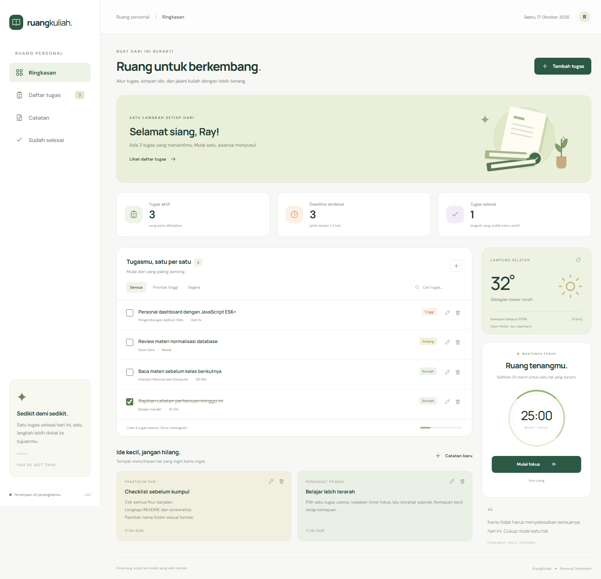
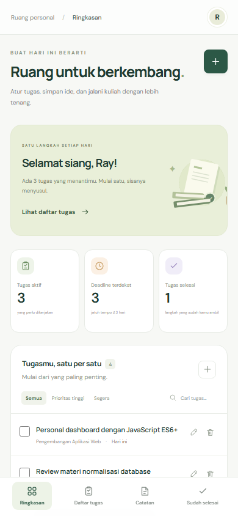

# RuangKuliah — Personal Dashboard

**Nama:** Ray Regan Sitepu  
**NIM:** 123140047  
**Mata kuliah:** Praktikum Pengembangan Aplikasi Web, ITERA  
**Pertemuan:** 2 — JavaScript Next Gen (ES6+)

RuangKuliah adalah dashboard personal untuk membantu mahasiswa mengatur tugas kuliah dan menyimpan catatan. Aplikasi dibuat dengan HTML, CSS, dan JavaScript murni agar penerapan ES6+ mudah dibaca. Tidak menggunakan framework, database, atau dependensi npm.

Referensi: [instruksi tugas](https://praktikum-paw20262027.vercel.app/pertemuan/2/tugas-praktikum) dan [format pengumpulan](https://praktikum-paw20262027.vercel.app/pertemuan/2/format-pengumpulan).

## Menjalankan aplikasi

1. Buka terminal di folder `rayregansitepu_123140047_pertemuan2`.
2. Pastikan Node.js 22 atau lebih baru sudah terpasang.
3. Jalankan:

   ```sh
   node server.js
   ```

4. Buka **http://localhost:3000** di browser.
5. Tekan `Ctrl+C` di terminal untuk menghentikan server.

Alternatifnya, jalankan `npm start`. Tidak perlu `npm install`. File `index.html` juga dapat dibuka langsung pada browser modern, tetapi server lokal dianjurkan agar origin penyimpanan konsisten. Jika port 3000 dipakai aplikasi lain, ubah port melalui environment variable `PORT`.

## Fitur dan penggunaan

| Fitur | Cara menggunakan |
| --- | --- |
| Tambah tugas | Klik **Tambah tugas** atau tombol **+**, isi judul, mata kuliah, deadline, prioritas, dan catatan tambahan. |
| Edit tugas | Klik ikon pensil pada tugas. Detail dan catatan tambahan dapat dibaca serta diubah dari formulir ini. |
| Hapus tugas/catatan | Klik ikon tempat sampah, lalu konfirmasi penghapusan. |
| Selesai / buka kembali | Centang kotak tugas. Hilangkan centangnya untuk membuka kembali tugas. |
| Navigasi | **Ringkasan** memuat semua tugas; **Daftar tugas** memuat tugas aktif; **Sudah selesai** memuat tugas selesai. |
| Profil pribadi | Klik avatar **R** di kanan atas untuk melihat nama lengkap dan NIM dalam pop-up di halaman yang sama. Tutup melalui ikon **×**, tombol **Kembali ke dashboard**, atau tombol **Escape**. |
| Filter dan pencarian | Gunakan **Semua**, **Prioritas tinggi**, atau **Segera**, dan cari tugas berdasarkan judul, mata kuliah, atau catatan tambahan. Filter Segera mencakup tugas terlambat dan deadline dalam tiga hari. |
| Catatan pribadi | Klik **Catatan baru** atau buka menu **Catatan**. Buat, edit, dan hapus ide atau rangkuman. Menu Catatan menampilkan isi lengkap. |
| Statistik | Jumlah tugas aktif, deadline dekat, dan tugas selesai diperbarui otomatis, termasuk persentase penyelesaian. |
| Cuaca ITERA | Data suhu, kondisi, dan kecepatan angin diambil dari Open-Meteo. Klik ikon perbarui untuk mengambil data terbaru. |
| Timer fokus | Klik **Mulai fokus** untuk sesi 25 menit, jeda/lanjutkan bila perlu, atau **Atur ulang**. Timer memakai timestamp agar tetap akurat saat tab berada di latar belakang. |
| Penyimpanan otomatis | Semua perubahan tugas/catatan disimpan ke localStorage. Perubahan juga disinkronkan ke tab lain dengan origin yang sama. |
| Responsif | Tampilan menyesuaikan desktop, tablet, dan ponsel; navigasi menjadi menu bawah pada ponsel. |

Saat pertama dibuka, dashboard menyediakan empat contoh tugas dan dua contoh catatan. Contoh tersebut dapat diedit atau dihapus. Setelah perubahan pertama, seluruh daftar disimpan sebagai data pengguna. Menghapus semua item menghasilkan daftar kosong yang tetap tersimpan setelah reload.

## Screenshot aplikasi

Screenshot diambil dari aplikasi yang berjalan di browser, bukan mockup. Angka cuaca dan tanggal berubah mengikuti waktu pengambilan data.

### Desktop



### Ponsel



## Implementasi ES6+

Nomor baris berikut merujuk ke versi kode yang dikumpulkan. Klik nama fungsi untuk membuka file terkait di GitHub.

| Fitur | Lokasi | Penerapan |
| --- | --- | --- |
| `const` | [js/app.js:4](js/app.js#L4) | Konstanta kunci penyimpanan; referensi dan fungsi yang tidak di-assign ulang. |
| `let` | [js/app.js:55](js/app.js#L55), [js/app.js:296](js/app.js#L296), [js/app.js:327](js/app.js#L327) | Nilai yang dapat di-assign ulang: data mentah penyimpanan, sapaan, dan cache cuaca. |
| Arrow function 1 | [js/app.js:7](js/app.js#L7) | `$` sebagai helper `document.querySelector`. |
| Arrow function 2 | [js/app.js:10](js/app.js#L10) | `escapeHTML` untuk menampilkan input pengguna sebagai teks aman. |
| Arrow function 3 | [js/app.js:14](js/app.js#L14) | `daysUntil` menghitung jarak deadline. Arrow function lain juga digunakan pada event listener dan metode array. |
| Template literals | [js/app.js:247](js/app.js#L247), [js/app.js:254](js/app.js#L254) | `taskTemplate` dan `noteTemplate` merender HTML dinamis melalui interpolasi `${...}`. |
| Class | [js/app.js:26](js/app.js#L26) | `TaskItem` memodelkan dan memvalidasi setiap tugas/catatan. |
| Class | [js/app.js:46](js/app.js#L46) | `DashboardStore` mengelola data dan operasi localStorage. |
| Class | [js/app.js:126](js/app.js#L126) | `DashboardApp` mengelola interaksi, rendering, timer, dan pemanggilan API. Penyimpanan didelegasikan ke `DashboardStore`. |
| Async/await | [js/app.js:308](js/app.js#L308) | `loadWeather` mengambil data Open-Meteo dengan `await fetch()` dan `await response.json()`, serta `try/catch/finally`. |
| Destructuring | [js/app.js:27](js/app.js#L27), [js/app.js:248](js/app.js#L248) | Mengambil field dari parameter konstruktor dan objek tugas. |
| Spread operator | [js/app.js:96](js/app.js#L96), [js/app.js:98](js/app.js#L98) | Memperbarui objek dan array state tanpa memutasi state sebelumnya. |
| Metode array modern | [js/app.js:110](js/app.js#L110), [js/app.js:116](js/app.js#L116) | `filter`, `map`, `find`, dan `sort` untuk statistik, CRUD, filter, serta rendering. |
| Default parameter | [js/app.js:10](js/app.js#L10), [js/app.js:116](js/app.js#L116) | Nilai bawaan pada fungsi helper dan filter daftar. |

## Pengelolaan data

- Kunci **`ruangkuliah:data:v1`** menyimpan JSON `{ version: 1, items: [...] }`.
- Setiap item memiliki `id`, `kind`, `title`, `course`, `due`, `priority`, `content`, `completed`, dan `createdAt`.
- Data dibaca ketika aplikasi dimulai, lalu dibentuk kembali menjadi objek `TaskItem`.
- `DashboardStore.commit()` di [js/app.js:87](js/app.js#L87) menulis perubahan ke localStorage **sebelum** mengubah state. Jika penyimpanan penuh/diblokir, aplikasi menunjukkan pesan dan mempertahankan state sebelumnya.
- Data rusak tidak ditimpa secara otomatis. Pesan pemulihan ditampilkan; pengguna dapat memulihkan atau menghapus kunci terkait dari Developer Tools → Application → Local Storage.
- Kunci **`ruangkuliah:weather:v1`** menyimpan hasil API beserta waktu pengambilan untuk fallback saat koneksi terputus. Label cache mencantumkan waktu agar data lama tidak dianggap sebagai cuaca terbaru.
- Data lokal melekat pada browser, perangkat, dan origin yang digunakan. Menghapus data situs akan menghapus tugas dan catatan. Timer fokus berlaku selama halaman terbuka dan kembali ke 25 menit setelah reload.

## API dan penanganan asinkron

Endpoint yang digunakan:

```text
https://api.open-meteo.com/v1/forecast?latitude=-5.36&longitude=105.31&current_weather=true&timezone=Asia%2FJakarta
```

Endpoint mengikuti rekomendasi pada modul tugas dan tidak memerlukan API key. Permintaan dibatasi delapan detik menggunakan `AbortController`. Respons diperiksa sebelum ditampilkan. Saat jaringan gagal, aplikasi memakai cache bila tersedia; jika belum ada cache, widget menampilkan pesan untuk mencoba lagi. Fitur tugas dan catatan tetap dapat dipakai tanpa internet. Font daring memiliki fallback sans-serif.

## Struktur proyek

```text
rayregansitepu_123140047_pertemuan2/
├── index.html
├── css/
│   └── style.css
├── js/
│   └── app.js
├── assets/
│   ├── favicon.svg
│   ├── dashboard-desktop.png
│   └── dashboard-mobile.png
├── tests/
│   └── dashboard.test.js
├── server.js
├── package.json
├── .gitignore
└── README.md
```

## Pengujian

Jalankan pengujian logika data:

```sh
npm test
```

Alternatif tanpa npm:

```sh
node --test tests/dashboard.test.js
```

**Hasil:** 5 pengujian lulus. Cakupannya meliputi CRUD, persistensi setelah pemuatan ulang, perubahan state immutable, filter/pencarian, validasi input, kegagalan penyimpanan, data rusak, serta escaping HTML.

**Verifikasi browser desktop dan ponsel:** tambah/edit/hapus tugas dan catatan, konfirmasi penghapusan, status selesai, pencarian, persistensi setelah reload, rendering input HTML sebagai teks, timer mulai/jeda/reset, pengambilan API cuaca riil, dan penanganan kegagalan request cuaca. Tidak ditemukan exception JavaScript yang tidak tertangani atau overflow horizontal pada viewport 1440 dan 390 piksel.

## Format pengumpulan

Masukkan folder ini ke repository **`pemrograman_web_itera_123140047`**, sesuai format yang tercantum pada modul. Sertakan kode dan screenshot dalam repository. Tautan repository dan laporan dikumpulkan melalui formulir kelas praktikum masing-masing.
